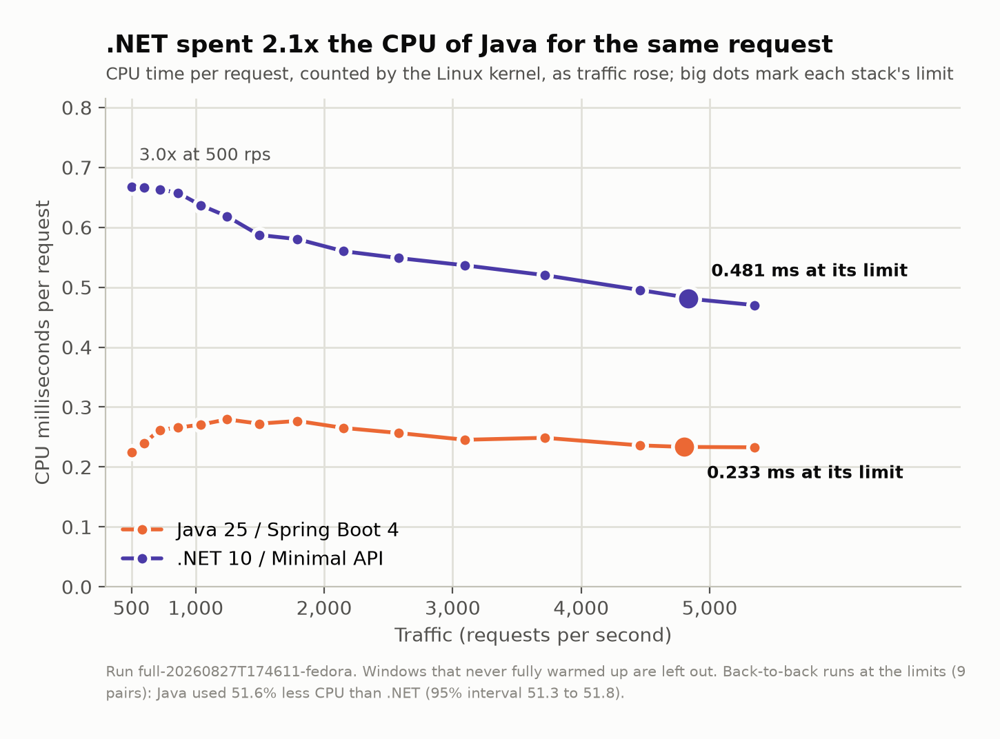

# Ledgerline: Java 25 vs .NET 10 on a realistic backend workload

**A reproducible benchmark that asks what a backend service costs to run, not how
many requests it can shout per second.**

> **Status:** one published measured run (August 2026), with every artifact behind
> its numbers committed. Not under active development. Methodology challenges are
> welcome and get re-run: see [Disagreeing productively](#disagreeing-productively).

The same invoicing API, specified once and implemented twice: in **Java 25 LTS**
(Spring Boot 4, WebMVC on virtual threads, Spring Data JPA + Hibernate 7) and
**.NET 10** (Minimal API + EF Core). Both hit a shared PostgreSQL 18.4 and Redis.
The measured quantity is **cost at a fixed latency promise**: CPU-ms and
steady-state memory per request at the rate where mixed-workload p99 crosses
20 ms, read from cgroup v2 rather than from anything the process says about
itself.

ORM against ORM is deliberate. EF Core and Hibernate are the mainstream
production choice on each side, and comparing one stack's ORM against the other's
hand-written SQL measures the data layer rather than the runtime.

The service under test has a codename, **Ledgerline**, the way TechEmpower's test
is called Fortunes. You will see it in container names, package names and the run
artifacts. It is just a label for the invoicing API described below.

Everything in `spec/` (the workload, the SLO, the decision rule, every fairness
dial) was frozen before the measured run, so results cannot be retrofitted. Every
run manifest records a `config_hash` over all of `spec/`. Nothing enters `spec/`
as a declared gate until its implementation exists and its test passes.

### The headline

From run `full-20260827T174611-fedora`: **44,403,343 requests** across 116
measured windows of one cell, in about 16.5 hours of wall-clock on one tuned
Ryzen 9 7950X, with no crash and no resume.

- **Capacity is a tie.** Each stack's own p99 crossed 20 ms at nearly the same
  rate: a fitted knee of **4,799 req/s for Java and 4,833 req/s for .NET**.
- **Java spent 0.49x .NET's CPU.** At those rates the app containers used 0.233
  against 0.481 CPU-ms per request. Paired by block: Java -51.6%, 95% interval
  [-51.8, -51.3].
- **.NET held 0.27x Java's memory.** In-window anonymous memory p99 was 176 MB
  against 656 MB.
- **The database did not care.** PostgreSQL's own CPU per request was 0.101 ms
  serving Java and 0.115 ms serving .NET (0.88x), so the CPU gap is in the
  application process and not in the SQL either ORM generates.
- **Per-request CPU is not a stack constant.** The Java : .NET ratio runs from
  0.34x at 500 req/s to 0.50x at 5,350. .NET's cost falls as load rises
  (coefficient of variation 12.5% across the rungs); Java's is flatter (7.1%).



Three caveats travel with those numbers, and the report prints all of them:

1. **Nine paired blocks, not the pre-registered ten.** One block was dropped for an
   under-warmed .NET probe, so the paired verdicts are labelled *directional*.
2. **The knee intervals are not inferential.** The crossing bracket holds two or
   three measurement-grade reps per stack, so the bootstrap interval is a spread
   indicator, not a confidence interval.
3. **The fitted knees run optimistic.** Re-run at exactly those rates in the
   confirm stage, mean p99 was 26.6 to 28.9 ms rather than 20, for both stacks.
   "The promise was met at the knee" is therefore **not** claimed. The cost ratio
   does not depend on it: it sits between 0.46x and 0.50x on every rung from
   1,493 to 5,350 req/s.

Every figure under [`docs/figures/`](docs/figures/) is drawn by
[`bench/figures.py`](bench/figures.py) from the run's own artifacts, and it
refuses to draw if its numbers disagree with the report's. `make figures
RUN=<run_id>` redraws them; no measured number on them is typed by hand.

Full tables: [`results/full-20260827T174611-fedora/report/report.md`](results/full-20260827T174611-fedora/report/report.md).
Everything the run does **not** establish is listed there and in
[`results/README.md`](results/README.md); read that before quoting a number.

---

## Start here

Which of these are you?

| you want to | go to |
|---|---|
| run it yourself, on any OS, in a few minutes | [Functional tier](#functional-tier-any-os) |
| reproduce the measured numbers | [Measured tier (Linux)](#measured-tier-linux) |
| read the results of the published run | [Reading a run](#reading-a-run) |
| check whether the method is sound | [`docs/METHODOLOGY.md`](docs/METHODOLOGY.md) |
| argue that a dial is unfair | [`docs/FAIRNESS.md`](docs/FAIRNESS.md) |
| hack on the services | [What's in here](#whats-in-here) |

## What the workload actually is

Six endpoints, one frozen request mix (`spec/workload.yaml`):

| share | endpoint | what it exercises |
|---|---|---|
| 30% | `GET /invoices/{id}` | cache-aside through Redis, PostgreSQL on miss |
| 25% | `GET /customers/{id}/invoices?page=N` | paged query, skewed to page 1 |
| 20% | `POST /pricing/quote` | ~8 KB body, 50 items, pure CPU pricing algorithm |
| 15% | `POST /invoices` | ~2 KB body, real multi-statement transaction + cache invalidation |
| 8% | `POST /invoices/{id}/pdf-stub` | deterministic 32 KB buffered write |
| 2% | `GET /healthz` | liveness |

Keys are drawn Zipf-hot (alpha 1.0) from 1M seeded customers and 5M seeded
invoices. Each attack draws its own targets from its own deterministic stream, so
a probe's warmup does not pre-populate the cache with exactly the ids its measured
window is about to ask for. The realized Redis hit rate is measured rather than
assumed: the published run saw **0.629** against the 0.80 the workload was built
to target, and the report explains the gap.

Both implementations are idiomatic. No hand-rolled routers, no pre-built byte
arrays, no leaderboard tricks. A cross-service equivalence suite enforces that
they behave identically on the wire, and it is a gate the run has to pass before
any cell is measured; it passed 19 of 19 inside the published run.

### Versions

Everything here is pinned in a committed file, so the table is checkable rather
than remembered. The runner also reads the running versions and image digests
back off the box into `manifest.versions`; a manifest with nothing there records
the *absence* of a reading, never a default.

| component | version | pinned in |
|---|---|---|
| Java | Temurin 25.0.4_7 (LTS) | `services/java/Dockerfile` (digest-pinned), `pom.xml` (`java.version` 25) |
| Spring Boot | 4.1.1 | `services/java/pom.xml` (parent) |
| Hibernate / HikariCP / Lettuce / Jackson / Tomcat | whatever the Boot 4.1.1 BOM ships | `services/java/pom.xml`, deliberately not overridden |
| Maven | 3.9.16 via `mvnw` | `services/java/.mvn/wrapper/maven-wrapper.properties` |
| .NET | 10.0 (runtime 10.0.11 in the published run) | `services/dotnet/Ledgerline.csproj` (`net10.0`), SDK + `aspnet:10.0-noble` images digest-pinned |
| EF Core | 10.0.11 | `Ledgerline.csproj` (`Microsoft.EntityFrameworkCore.Relational`) |
| Npgsql | 10.0.3 | `Ledgerline.csproj` (`Npgsql`, `Npgsql.EntityFrameworkCore.PostgreSQL`) |
| Dapper | 2.1.79 | `Ledgerline.csproj` (the `dapper` data layer; no measured cell, per D5) |
| StackExchange.Redis | 3.1.31 | `Ledgerline.csproj` |
| PostgreSQL | 18.4 | `infra/compose.yaml` (`postgres:18.4-bookworm`, digest-pinned) |
| Redis | 8.10.0 | `infra/compose.yaml` (`redis:8.10.0-trixie`, digest-pinned) |
| vegeta | v12.13.0 | `infra/vegeta/Dockerfile`, built from source on the locked Go toolchain |

.NET runs plain `dotnet publish -c Release`: tiered JIT with dynamic PGO, **no
ReadyToRun and no Native AOT**. Java runs the Boot fat jar on HotSpot with no AOT
cache and no CDS archive. Both are their stack's documented default; see
[`docs/FAIRNESS.md`](docs/FAIRNESS.md) for why.

## Prerequisites

```sh
git clone https://github.com/HaikAsatryan/java-vs-dotnet-benchmark.git && cd java-vs-dotnet-benchmark
```

- **Docker** with Compose v2. Docker Desktop is fine for the functional tier; the
  measured tiers need rootful Docker with cgroup v2 unified.
- **[uv](https://docs.astral.sh/uv/)** to run the Python benchmark runner.
- **make** for the thin wrappers. On Windows use Git Bash or WSL, or run the
  underlying `uv run ledgerbench …` / `docker compose …` commands directly.
- JDK and .NET SDKs are **not** required: the services build inside Docker. You
  only need them to hack on the services themselves, and the Java side ships a
  Maven wrapper (`./mvnw`), so no Maven install is needed either.
- For the **measured tier only**: root, or a NOPASSWD `sudo` grant for the
  operator. `make doctor` fails the run without it, because host tuning shells out
  to `sudo -n`.

## Functional tier (any OS)

This proves everything builds, seeds and behaves identically. It **measures
nothing** and is safe to run on a laptop, including Windows.

```sh
cd bench && uv sync && uv run pytest   # pure-logic suites, no Docker needed
make smoke                             # build, seed a tiny dataset,
                                       # run the equivalence suite, fire a short probe
```

If `make smoke` passes, your environment is sound and both services agree with
the spec.

## Measured tier (Linux)

Measured runs are Linux-only and the `make bench-*` / `host-setup` targets are
gated to refuse anywhere else. The published full run took about 16.5 hours for
its one cell; budget a day.

```sh
make doctor        # preflight
make seed-full     # seed 1M customers / 5M invoices via the dockerized seeder
make host-setup    # Tier-1 host tuning: READ THE WARNING BELOW FIRST
make bench-rehearsal        # reduced MEASURED tier: validate the numbers first
make bench-all              # capacity gate -> validation -> cells -> re-gate -> soak
make analyze RUN=<run_id>   # knee fits, stats, report tables -> results/<run_id>/report/
make verify RUN=<run_id>    # recheck the published artifacts against CHECKSUMS.sha256
make figures RUN=<run_id>   # redraw docs/figures/*.png from the run's artifacts
make host-restore  # undo everything host-setup changed
```

> **`make host-setup` mutates your machine.** It changes the CPU governor, turns
> boost off, caps C-states, sets THP mode, re-steers IRQs, installs a systemd
> `CPUAffinity` drop-in and sets `chattr +C` on the pgdata directory.
> Every mutation writes its original value to a state file, and **`make host-restore`
> replays that file to undo all of it**. Run it on a box you own and can reboot, not
> on a shared machine. `infra/host-setup.sh` without `--tune` only detects and
> reports, changing nothing.

`make bench-all` runs the single headline cell, `headline.mixed.gc-default`: GC
and heap flags at their defaults on both sides. A second, heap-equalised cell
was planned and then deleted (decision D6 in [`PROGRESS.md`](PROGRESS.md)): the
rehearsal measured the JVM's committed heap peaking at 298 MB against a default
ceiling of about 3 GiB, so the ceiling never binds and that cell would have
measured nothing.

One variant cell, `variant.npgsql-default-prepare`, is declared but not executed
unless you ask for it, because it costs a full cell of run time. There are no
raw-ADO.NET or Dapper cells (decision D5): that axis was measured in
[round 1](https://github.com/HaikAsatryan/go-vs-dotnet-benchmark), a separate
Go vs .NET benchmark. Both data layers remain in `services/dotnet` as code, and
the harness shakedown uses `ado` as its second slot.

```sh
LEDGERBENCH_RUN_VARIANTS=variant.npgsql-default-prepare make bench-all
```

Set that and `LEDGERBENCH_BODY_POOL_REQUESTS` **before** starting a run: both are
pinned into the ledger at run start and the pin wins on resume.
`uv run ledgerbench --help` lists the operator knobs;
[`docs/RUNBOOK.md`](docs/RUNBOOK.md) explains what each one costs.

`analyze` reports, it does not gate. The runner **aborts** the measured cells on a
non-passing capacity gate, on a slot that reaches the rung ceiling without
crossing the SLO, and on a failing capacity re-gate; each abort has a named
opt-out (`LEDGERBENCH_ALLOW_DB_IMPOSED_KNEE` for the gate and re-gate,
`LEDGERBENCH_ALLOW_SUB_KNEE_LADDER` for the ceiling) that stamps `degraded`
into the run's artifacts rather than passing silently. `analyze`
**excludes** under-warmed probes itself and prints the used/flagged-excluded
counts per row. [`docs/RUNBOOK.md`](docs/RUNBOOK.md#full-run-sequence) lists
exactly which files to read before publishing anything.

### Interruptions

The run is resumable at probe granularity. After any interruption:

```sh
make bench-status   # where it stopped: phase states, per-cell progress, next pending item
make bench-resume   # resume the most recent unfinished run
```

Host re-tuning, host-state read-back and DB invariant checks happen automatically
on resume, finished probes never re-run, and an interleave block split by a crash
is redone whole so the pairing stays honest.

### Reproducibility tiers

- **Tier 1 (exact).** The intended measurement host is one machine: Ryzen 9
  7950X, two 8-core CCDs, Fedora 43, NVMe, with `infra/host-setup.sh --tune`
  applied. Reproducing a published run exactly needs that class of setup.
- **Tier 2 (directional).** A Linux box with cgroup v2 and enough hardware can run
  the same procedure; `--tune` detects and skips what it cannot apply. The real
  floor is set by `infra/compose.bench.yaml`, which pins cpusets and memory: 6 cores
  and 12 GB for each SUT, 3 cores and 8 GB for PostgreSQL, 3 cores and 4 GB for the
  load generator, 1 core and 2 GB for Redis, plus a core for the runner. That is
  **15+ physical cores and about 26 GB** on the default layout. Every cpuset and
  limit is env-parameterized, so a smaller box means editing those knobs and
  accepting that you changed the experiment. Expect the ratios to hold
  directionally, not the absolute numbers; the knobs are documented in
  [`docs/RUNBOOK.md`](docs/RUNBOOK.md).
- **Functional (any OS).** `make smoke`. Proves behaviour, measures nothing.

## Reading a run

A finished run lives in `results/<run_id>/`:

| file | what it answers |
|---|---|
| `report/report.md` | **start here.** Per-slot knee fits, p99 against the SLO, cost-vs-rate, resource roll-ups, paired verdicts |
| `report/fits.json` | the same numbers as data, if you want to plot or re-analyse them |
| `manifest.json` | provenance: versions and image digests read back, host state read back, knobs, capacity gate, config hash, achieved-vs-offered per probe |
| `ledger.json` | crash-safe run state; per-probe p99, which warmup gates were evaluated and which failed, exclusions |
| `capacity-gate/verdict.json` | the pre-run gate; the post-cell-1 re-gate verdict rides in the manifest |
| `cells/<cell>/<stage>/rate<N>/block<M>/` | the raw evidence: per-probe vegeta summaries, warm-up gate records, cgroup CPU/memory deltas for all six sampled cgroups, `/runtime-stats` traces |
| `CHECKSUMS.sha256` | sha256 over exactly the published artifacts, recomputed whole at the end of the run and again by `analyze`: run `sha256sum -c CHECKSUMS.sha256` from the run directory, or `uv run ledgerbench verify <run_id>` (non-zero exit on any tampered, missing or unaccounted file) |

Two habits will keep you out of trouble:

1. **Read the used/flagged-excluded counts next to any figure.** A row built from
   one or two warm windows is not the same object as one built from ten, and the
   report says which it is.
2. **Rows marked `*` are posture, not measurement.** They come from windows that
   failed a warm-up gate and are shown for direction only.

## What's in here

| path | what |
|---|---|
| `spec/` | the single source of truth both services implement: DDL, OpenAPI, workload, SLO + knee/warm-up numerics, frozen pricing algorithm, logging + DB-access + cache contracts, PostgreSQL config |
| `services/java` | Java 25: Spring Boot 4 WebMVC on virtual threads, Spring Data JPA + Hibernate 7, HikariCP, Lettuce, hand-written structured logging |
| `services/dotnet` | .NET 10: Minimal API, EF Core 10 + Npgsql, raw-ADO.NET and Dapper variants behind `DATA_LAYER`, MEL JSON console |
| `seed/` | deterministic seeder (seed 42): 1M customers / 5M invoices, binary COPY, invariant checks. It is Go, deliberately: it loads PostgreSQL and never runs inside a measured window, so it is tooling, not a system under test |
| `infra/` | Compose (portable base + Linux resource overlay), the vegeta image, host tuning scripts |
| `bench/` | Python runner (ladder → fit → confirm → soak, resumable), the cross-language equivalence suite, and analysis (isotonic knee fit, Mann-Kendall, paired-difference CI) |
| `results/` | the published run's manifest, ledger, per-probe summaries, report and checksums; [`results/README.md`](results/README.md) says what is and is not in there |
| `docs/` | [METHODOLOGY.md](docs/METHODOLOGY.md) (how every number is produced), [FAIRNESS.md](docs/FAIRNESS.md) (every dial, both sides, and why), [RUNBOOK.md](docs/RUNBOOK.md) (operating a measured run), `figures/` (the charts, generated) |

### The working record

Comments across this repo cite short identifiers: `D6`, `G6`, `P7`, `W17`,
`R1-A1`. They are defined in the project's working record, which is published as
it was written and frozen at publication:

| file | what it defines |
|---|---|
| [`PROGRESS.md`](PROGRESS.md) | the plan and its outcome: the pre-registered decisions (`D1`-`D12`), the phases and their gates (`P0`-`P10`, `G1`-`G8`) with the evidence each gate passed on, and the round-1 defects this round was built to fix (`R1-A*`, `R1-B*`) |
| [`docs/p1-plan.md`](docs/p1-plan.md) | the harness rebuild broken into work items (`W1`-`W31`) |
| [`docs/research/`](docs/research/) | the measured spikes and stack research the decisions rest on |
| [`CLAUDE.md`](CLAUDE.md) | the standing rules the AI coding assistant worked under while building this; several of them are enforced mechanically by `bench/tests/` |

These are a lab notebook, not polished documents. They are kept because `spec/`
(frozen, hashed) and the checksummed run report cite them, and a citation that
resolves is worth more than a tidy root directory.

Each of `bench/`, `infra/`, `seed/` and `services/dotnet` also carries a
`NOTES.md` recording the judgment calls made where `spec/` left a degree of
freedom, and both services carry a `NOTES-equivalence.md` capturing what they
actually put on the wire. If you want to know *why* something is the way it is,
those are where to look.

## Fairness, in one paragraph

Both services implement `spec/` exactly, enforced by golden and cross-service
equivalence tests. Pool sizes are pinned identical and asserted warm in every
cell; core parallelism is pinned and asserted on both sides; both drivers send
binary PARAMETERS from the first execution, while binary RESULT formats are an
asymmetry that is measured and disclosed rather than equalized (see
`spec/db-access.md`); neither side is left at a never-prepare
default while the other auto-prepares (PgJDBC auto-prepares out of the box, so
Npgsql's `Max Auto Prepare` is pre-registered on rather than discovered later,
and its documented default is kept as a declared variant cell instead of being
quietly fixed); GC and heap run at each runtime's documented defaults, with the
unequal heap ceilings disclosed rather than hidden; logging is contractually
identical; every probe runs the published multi-gate warm-up, its verdict is
recorded per probe with the gates it was actually held to, and `analyze` excludes
the flagged probes and prints the counts. The database runs in its own cgroup and
its CPU is sampled per window, so "Java costs more CPU" can be separated from
"Hibernate's query plans cost PostgreSQL more", and the capacity gate is
re-evaluated against the rates the cells actually chose rather than a pre-run
projection alone. The full list, including the asymmetries that count against
each side, is in [`docs/FAIRNESS.md`](docs/FAIRNESS.md).

## Disagreeing productively

Think a dial is unfair? Read [`docs/FAIRNESS.md`](docs/FAIRNESS.md), then open a
[methodology concern](.github/ISSUE_TEMPLATE/methodology-concern.md).
[`CONTRIBUTING.md`](CONTRIBUTING.md) describes what makes a report answerable.
Claims that come with a reproducible probe get taken seriously and re-run.

## Licence

This repository is [MIT](LICENSE): the spec, both service implementations, the
runner, the analysis and the committed run artifacts. Quote the numbers, re-run the
procedure, disagree with it in public.

One dependency is not MIT: the benchmark runs **Redis 8, which is AGPL-licensed**.
It is a pinned container image, not linked code, so it does not affect this
repository's licence, but Valkey is a documented drop-in if it matters for your
environment.

If you quote a number, please cite the run it came from: [`CITATION.cff`](CITATION.cff)
has the reference.
